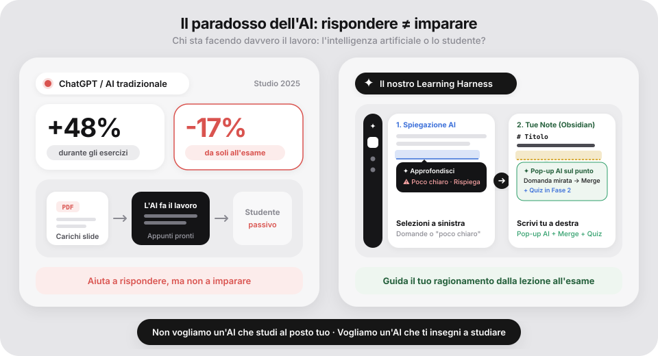
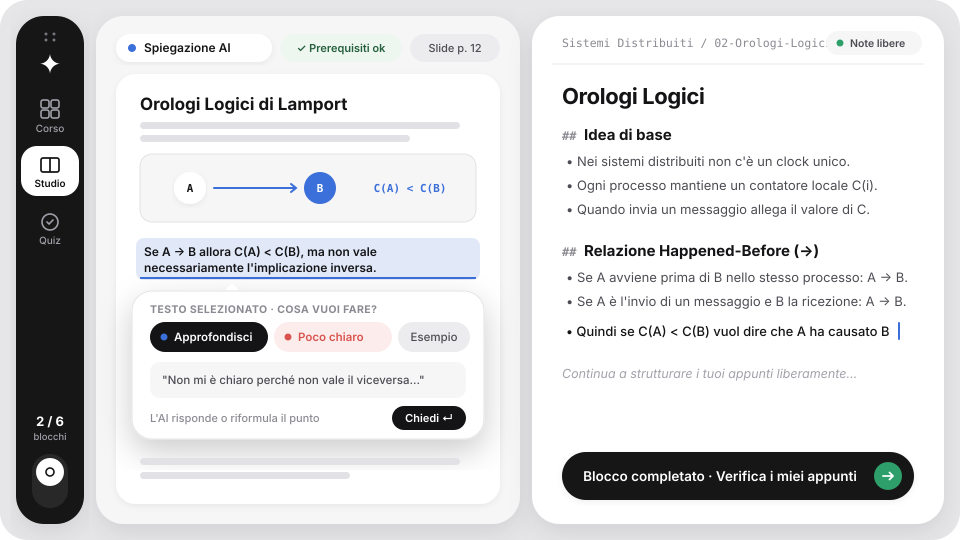
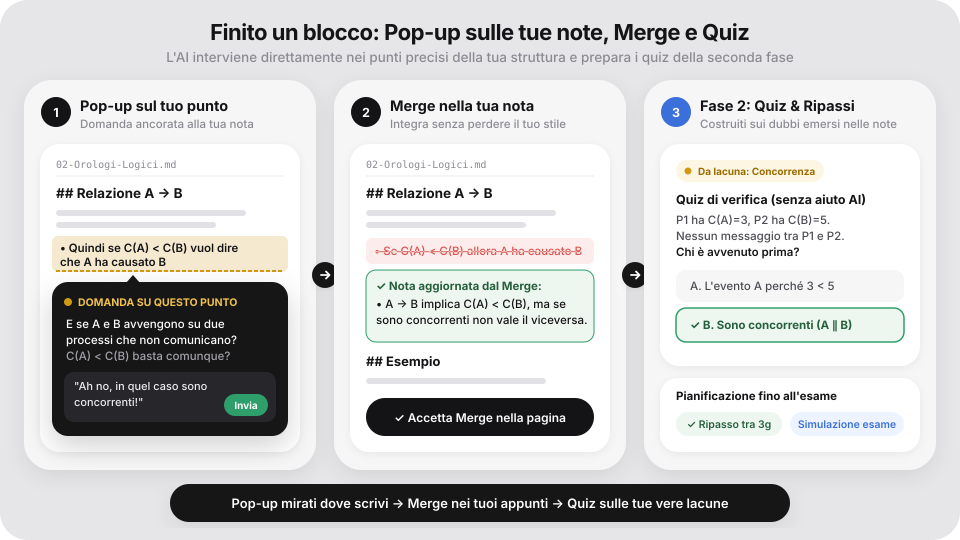

# Learning Harness — Presentazione da 1 Minuto

---

## Script da 1 Minuto (~140 parole · ~55 secondi)

### Slide 1 · Il Paradosso dell'AI (0:00 – 0:20)

> **Cosa dire:**
> "Nel 2025 uno studio scientifico ha mostrato un paradosso: gli studenti che usavano ChatGPT ottenevano il **48% in più** durante gli esercizi, ma il **17% in meno** quando dovevano affrontarli da soli.
> Oggi carichi le slide e ottieni ottimi appunti... ma chi ha fatto davvero il lavoro? **L'AI li aiutava a rispondere, ma non a imparare.**"

---

### Slide 2 · Fase 1: Studio nel Dual-Pane — Selezione a Sinistra & Blank Page Obsidian a Destra (0:20 – 0:40)

> **Cosa dire:**
> "Noi risolviamo questo problema con un **Learning Harness** che guida lo studente dalla prima lezione all'esame.
> Carichi slide e trascrizioni: il sistema organizza il corso, verifica i prerequisiti e lo divide in blocchi.
> **A sinistra** trovi la spiegazione dell'AI: puoi sottolineare qualsiasi frase per aprire un **pop-up di approfondimento** o segnalare che una spiegazione è **poco chiara**.
> **A destra**, invece, hai una **pagina bianca pulita come Obsidian**, dove sei **tu** a strutturare e scrivere i tuoi appunti con parole tue."

---

### Slide 3 · Fine Blocco & Fase 2: Pop-up sulle Note, Merge e Quiz Mirati (0:40 – 1:00)

> **Cosa dire:**
> "Quando finisci un blocco, i ruoli si invertono: l'AI analizza ciò che hai scritto e fa apparire dei **pop-up direttamente sui punti precisi dei tuoi appunti**, facendoti domande mirate sulle possibili incomprensioni.
> Una volta chiariti i dubbi, effettua il **merge** nella tua nota mantenendo la tua struttura, e in una **seconda fase** usa quelle stesse lacune per generare **quiz di verifica e ripassi** fino all'esame.
> **Non vogliamo un'AI che studi al posto tuo. Vogliamo un'AI che ti insegni a studiare davvero.**"
