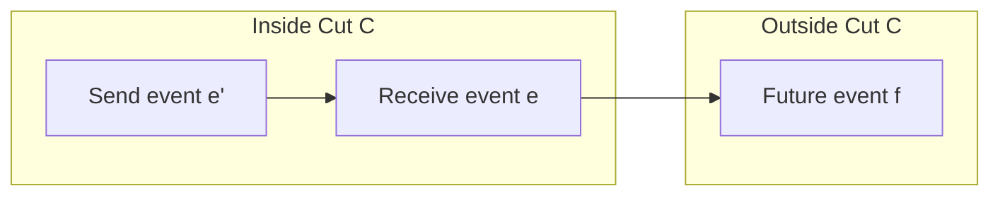
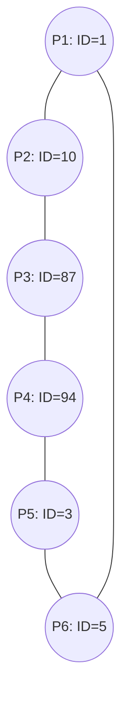

## Eventually Perfect Failure Detector ($\Diamond\mathcal{P}$), Leader Election ($\Omega$), Fault-Tolerant Mutual Exclusion & Consistent Cuts

### Summary of Topics Covered
1. **Eventually Perfect Failure Detector ($\Diamond\mathcal{P}$) Correctness Proof**: Proof of Strong Completeness and Eventual Strong Accuracy under the Partially Synchronous ($GST$) model.
2. **Transient Asynchrony and Stale Messages**: Why delayed messages can cause transient `restore` events after a process has crashed, and why this occurs at most finitely many times (mitigated by sequence numbers).
3. **Eventual Suspected Set Agreement**: Proof that all correct processes eventually reach consensus on the set of suspected processes: $\lozenge\square (S_1 = S_2)$.
4. **Leader Election & Eventual Leader Detector ($\Omega$)**: Definitions of Eventual Detection and Accuracy; why $\Omega$ is the weakest failure detector for consensus.
5. **Monarchical / Rank-Based Leader Election**: Implementing $\Omega$ using $\Diamond\mathcal{P}$ by electing $\min(\Pi \setminus \text{suspected})$.
6. **Hierarchy of Distributed System Models**: Classification from Asynchronous, to Partially Synchronous ($GST$), Fail-Stop, and Synchronous; why Synchronous is strictly stronger than Fail-Stop (Clock Synchronization).
7. **Fault-Tolerant Centralized Mutual Exclusion**: Handling crash of critical section holders, crash of queued waiting processes, and coordinator failure recovery.
8. **Vector Clocks & Consistent Cuts**: Computing vector clocks; definition of consistent cuts ($e \in C \land e' \to e \implies e' \in C$) and applications to distributed snapshots and checkpointing.
9. **Ring Leader Election Exercise**: Algorithm design on ring topologies with arbitrary unique IDs without knowing network size.

---

## Part 1: Eventually Perfect Failure Detector ($\Diamond\mathcal{P}$) Correctness Proof

### 1.1 Model Recap & Specification of $\Diamond\mathcal{P}$

So the idea is that in a system where we have a certain bound that is unknown to us, the system can have an arbitrary period of asynchrony before a certain time that is the Global Stabilization Time ($GST$), which is unknown. And after this period, the system will stabilize below the bound. So it means every message delay will be below this bound.

And our purpose was to create a failure detector that before $GST$—and also after that time—can have an arbitrary period where it can make mistakes: it can suspect processes that are actually correct. But there is a time, which can be greater than the stabilization time, after which our primitive will stabilize to a behavior that is that of a perfect failure detector. That means every suspect after this time will be correct: you cannot suspect a process that is correct, and every process that is crashing you will detect without problem. So that is Strong Completeness and Eventual Strong Accuracy.

We said the idea of the algorithm is to start with a certain delay $\Delta$, and this delay is the timeout that our algorithm uses. In our algorithm, we send a heartbeat message, we wait for the reply, and we use a timer to understand if the receiver replied. The idea is that every time we make a mistake—every time we see a process that is in $\text{alive}$ and is in $\text{suspected}$, so we understand that our algorithm made a mistake—the idea is that we restore the process, but also we increase the timeout $\Delta$.

The idea is that this timeout will grow fast enough and large enough to be greater than the bound of stability. So this will become greater than our stabilization bound in our system. And once this happens, after $GST$, we will not make any more mistakes, because our algorithm will suspect as crashing only processes that actually crashed.

Now, the Eventually Perfect Failure Detector ($\Diamond\mathcal{P}$) has two properties:
1. **Strong Completeness**: Eventually every process that crashes is permanently suspected by every correct process.
2. **Eventual Strong Accuracy**: Eventually no correct process is suspected by any correct process.

What remains to show is that this algorithm respects the two properties that we have seen right now.

### 1.2 Strong Completeness Proof

For Strong Completeness, the proof is simple enough. Strong Completeness says that if there is a process that fails—say, this is process $P$ that fails—then any correct process will eventually detect that $P$ fails and will never change opinion: it will never say $P$ is alive, $P$ is alive, $P$ is alive.

Why does this happen? If $P$ crashes, it will stop answering to requests. And so there will be a time after which, for any request that we send to this process, we cannot see the reply because the process has crashed.

Since it crashes, it's possible that you receive messages that were sent when the process was alive. But this number of messages is finite, right? Because this process crashed, so it could only send a finite number of messages before halting. So after you receive the messages that the process generated when it was alive, you will not receive any more replies to the new requests. And so you will detect it as crashing, and you will detect it as crashed forever, because there is no one to answer them. So Strong Completeness is easy enough.

### 1.3 Eventual Strong Accuracy Proof & Timeout Adaptation

What is the idea for the Eventual Strong Accuracy property? For Eventual Strong Accuracy, we have to consider our system after the stabilization time $GST$.

There is this time $GST$ that is unknown to us, and after this time our delay will always be below a certain bound that I call $D_{max}$. So after this time, for every heartbeat that I send to the process, it has to reply to myself after a time that is at most $2 D_{max}$ (the round-trip time). It's not possible that this ping-pong takes more than $2 D_{max}$.

Let us suppose that our timeout $\text{delay}$ at this point is above $2 D_{max}$. If the timeout of the algorithm once we stabilize is already above $2 D_{max}$, then it's not possible that you make a mistake, because you send the message, you wait more than $2 D_{max}$, so there is enough time for the message to reach the target and come back. So if at this point $\text{delay} \ge 2 D_{max}$, there is nothing to prove—it is obvious.

Now let's say that after the stabilization time, our $\text{delay}$ is below $2 D_{max}$. This is possible. What happens if it is below? It happens that we will start our timer and we will get the reply of the process after the timer expires, right? But if we get the reply of the process after that, then it means that here we made a mistake: we suspected the process when our timer expired, then we receive the message after, so the process will be in $\text{alive}$ for the next timer, and I will find that the process is in both $\text{alive}$ and $\text{suspected}$.

And what do I do? I will increase the delay:
$$
\text{delay} \leftarrow \text{delay} + \Delta
$$

How many times can I increase the delay? You can increase the delay a finite number of times, because eventually our delay will exceed $2 D_{max}$. And when our delay becomes above $2 D_{max}$, you cannot make mistakes anymore because of what we said previously: there is enough time to reach the target and come back, and you cannot make mistakes anymore. And this proves Eventual Strong Accuracy.

So for every process that is correct in the system, any other process can suspect it for a finite time, but after a certain bound, we never suspect it wrongly.

## Part 2: Stale Messages, Transient Restorations & Suspected Set Agreement

### 2.1 Thought Experiment: Observing `restore` Long After a Process Crash

Are there questions on the algorithm before we progress to the next one? Questions or observations on the algorithm? Okay, I have an observation.

Let us say that we have our correct process $P_1$, and there is process $P_2$ that is faulty and crashes at this time. Let's say that this is time 10, just to put a number on it. We are running this algorithm. Is it possible that at a certain time 100, on process $P_1$, we see `restore(P2)`?

Is it possible that after time 100, I see on process $P_1$ the event `restore(P2)`, even if process $P_2$ departed from the system at time 10? Can we have this situation in this algorithm? So can I have that process $P_1$ sees here `suspect(P2)`, and then after a lot of time, receives an event from the algorithm that says `restore(P2)`? Is it possible or not?

> **Student:** Could you have sent a message and it had been lost for that time?
>
> **Professor:** Sorry, can you repeat?
>
> **Student:** Could you have sent a message and it had been delayed for time 90, for example?
>
> **Professor:** Exactly! Not lost—delayed! One possibility is this one: at time 9, you send a message to $P_2$ and you ask $P_2$: "Are you alive?" And $P_2$ answers because he is still alive. But the system was asynchronous before $GST$, and so this message takes a huge delay—say, 110 seconds.
>
> So it means that this message you will receive here at time 100. Once you receive the message here, you receive this reply, and you do not know that it is an old one! So when you receive the reply, you will say: "Oh, the process is alive!"
>
> But notice that this situation cannot happen indefinitely. Here it's possible that you asked three times, and you have three messages that will come back in the future. But this number of messages is finite! And so there will be a time after which all these old messages have been received, and you cannot say `restore(P2)` anymore.
>
> But it's possible that for an undefined finite time after the crash of $P_2$, someone will still restore it, because in this basic algorithm you don't have a way to detect old messages.
>
> **Student:** This can only happen when the system was still asynchronous?
>
> **Professor:** Yes! If you send a message during the asynchronous period, it can take one hour, and you receive it one hour later, even if the system has become synchronous in the meantime.

### 2.2 Discarding Outdated Messages via Sequence Numbers

Can someone suggest how to avoid this situation? This is not a violation of the specification—the algorithm still respects the properties—but what is a way to avoid this?

What is the problem with this message? The problem is that this message was the reply to an old ping. How can we easily understand that this is an old reply?

> **Student:** Put some numbers... Sequence numbers!
>
> **Professor:** Sequence numbers! Exactly. You say ping 1, ping 2, ping 3... and now this is ping 100. If I see the reply to ping 3 and I am currently at ping 100, I say: "This is an old message," and I discard it!
>
> Notice that for the specification, delayed messages are not a problem, because Strong Completeness only requires eventual permanent suspicion. But if you want to eliminate this transient effect, you can use sequence numbers.
>
> **Student:** Is it better to use sequence numbers than timestamps?
>
> **Professor:** The benefit is just that you discard old messages from dead processes faster. But you cannot eliminate the fundamental problem of eventual synchrony: if a process is alive and slow, you can still falsely suspect and restore it during the asynchronous phase.

### 2.3 Lemma: Eventual Equality of Suspected Sets ($\lozenge\square (S_1 = S_2)$)

Now there is one property that I want to show because it will be useful for the next algorithm. Our algorithm maintains this $\text{suspected}$ set, in which we put the processes that we suspect.

> **Lemma:** Take two correct processes $P_1$ and $P_2$, and let $S_1$ and $S_2$ be the suspected sets of these two processes. There is a stabilization time $T$ after which:
> $$
> \lozenge\square (S_1 = S_2)
> $$
> That is, the suspected sets on any two correct processes eventually become identical and remain identical forever.

It's possible that at a certain point during asynchrony, they suspect different people: $P_1$ suspects $P_3$ and $P_2$, while $P_2$ suspects $P_1$ and $P_4$. But there is a time after which the suspected set on $P_1$ will always be equal to the suspected set on $P_2$.

What is the proof? Let us suppose by contradiction that this is not true. If this is not true, then for any time in the future, $S_1 \neq S_2$.

If two sets are different, there must exist an element that is in one set and not in the other. (Because if all elements of $S_1$ are in $S_2$ and all elements of $S_2$ are in $S_1$, they are equal). So there must exist some process $P$ such that $P \in S_1$, but $P \notin S_2$.

Now, let us analyze the two cases for process $P$:
1. **Case 1: $P$ is a crashed process.**
   If $P$ is a crashed process, then by Strong Completeness, every correct process must permanently suspect $P$. Therefore, $P_2$ must also permanently suspect $P$, which means $P$ must eventually belong to $S_2$ forever. So it is impossible that $P \notin S_2$ forever. Contradiction!
2. **Case 2: $P$ is a correct process.**
   What is the contradiction if $P$ is a correct process?
   If $P$ is correct, it shouldn't be in $S_1$! By Eventual Strong Accuracy, no correct process can be suspected forever by any correct process. So $P$ must eventually be removed from $S_1$. Contradiction!

In both cases, we reach a contradiction. Therefore, all processes that stay in $S_1$ must also stay in $S_2$, meaning the two suspected sets must eventually become identical:
$$
S_1 = S_2
$$

Intuitively, this is obvious: after stabilization, no correct process is suspected, and all crashed processes are permanently suspected by everyone. So everyone's suspected set converges to the exact set of crashed processes.

## Part 3: Leader Election & The Eventual Leader Detector ($\Omega$)

### 3.1 Leader Election Abstraction & Motivation

So there is another primitive that is used in distributed computing as an alternative or complement to failure detectors: the **Leader Election primitive**.

The Leader Election primitive does not ask you to detect who fails, but asks you to identify one process that is correct and is the same process for everyone. We want to elect someone called the **leader** (or coordinator), and we need to know that this someone is the same for everyone in the system.

Why is this primitive interesting? Because if you have leader election, you can solve problems with a client-server approach: we elect a leader, everyone sends their requests to the leader, the leader solves the problem and sends the answer back.

What is the problem with a traditional client-server approach? If the server goes down, no one answers. Leader election solves this: if the current leader crashes, everyone detects it and elects a new leader—say, process $P_2$ because $P_1$ crashed. And everyone must agree on the leader, because if half the system trusts one leader and half trusts another, it's chaos!

> **Student:** If the leader has a long delay, could it ping that it is alive again?
>
> **Professor:** Yes, in an eventually synchronous system, that can happen! In a synchronous system, message delays are strictly bounded, so everyone has the same delay bound. But in an eventually synchronous system, a leader can be slow, causing a temporary demotion, and then stabilize later.
>
> We have two kinds of leader election:
> - **Leader Election**: in synchronous systems (the counterpart of $\mathcal{P}$).
> - **$\Omega$ (Omega) Eventual Leader Detector**: in eventually synchronous systems (the counterpart of $\Diamond\mathcal{P}$). It can make mistakes initially, but eventually stabilizes so that everyone trusts the same correct leader.

### 3.2 Specification of Eventual Leader Election ($\Omega$)

The Leader Election primitive exposes a single event:
- `leader(p)` (or `trust(p)`): indicates that process $p$ is trusted as the current leader.

Its specification requires two properties:
1. **Eventual Detection (Validity)**: Either there is no correct process, or some correct process is eventually elected as the leader. If there are processes alive, the primitive must elect one of them.
2. **Accuracy (Agreement)**: If a process is elected as leader, all previously elected leaders have crashed. (In the eventual version $\Omega$: eventually all correct processes trust the same correct process).

### 3.3 Execution Analysis: Multiple Leaders & Agreement

Let us trace an execution to make this clear. Suppose we have $P_0, P_1, P_2$. $P_0$ crashes at some point:
- Initially, everyone trusts $P_0$.
- Then $P_0$ crashes. Since the leader crashed, by the validity property we must elect a new leader.
- Suppose $P_1$ elects itself as the new leader (`leader(P1)`), while $P_2$ still believes $P_0$ is the leader.

Is this execution prefix possible for the primitive?

> **Student:** Yes, because it says *eventually*—they don't have to elect the new leader at the exact same instant.
>
> **Professor:** Exactly! You don't have to elect the same leader at the exact same physical moment. It's possible that $P_1$ elects the new leader while $P_2$ is still with the old one, as long as $P_2$ eventually switches to $P_1$.
>
> What kind of property is this? It's a **liveness property**!

Now, consider another execution: $P_0$ crashes. $P_1$ is elected as leader. Then, while $P_1$ is still alive, $P_2$ elects itself: `leader(P2)`.
Is this execution valid?

> **Professor:** No! Because $P_2$ elects a new leader while the old leader $P_1$ is still alive and correct! That violates the accuracy property: you cannot have two different alive leaders trusted at the same time, because that leads to disagreement.

### 3.4 Monarchical / Rank-Based Leader Election with $\mathcal{P}$

How do we implement leader election in a synchronous system with a Perfect Failure Detector $\mathcal{P}$?

> **Student:** We can define the leader as the process with the smallest ID, and whenever you detect that the leader is dead, you go to the next one!
>
> **Professor:** Exactly! That is called **Monarchical** or **Rank-Based Leader Election**.

```python
# Initialization:
suspected = ∅
leader = None

# Upon crash of process p:
upon event crash(p):
    suspected = suspected ∪ {p}

# Upon suspected set change:
upon leader != max_rank(Π \ suspected):
    leader = max_rank(Π \ suspected)
    trigger leader(leader)
```

At the beginning, we take the set of all processes $\Pi$. We define a total order on the processes (for example, by process ID or rank). The leader is simply:
$$
\text{leader} = \max(\Pi \setminus \text{suspected})
$$
*(or $\min$, depending on ordering).*

Since $\Pi$ is known to everyone and integer ordering is total, everyone computes the exact same maximum!
- When $P_2$ (the maximum) crashes, $\mathcal{P}$ emits `crash(P2)`.
- $P_2$ is added to $\text{suspected}$.
- The new maximum among alive processes is $P_1$.
- Everyone updates `leader = P1`.

Why is this algorithm correct?
- **Eventual Detection**: Follows directly from Strong Completeness of $\mathcal{P}$.
- **Accuracy**: Follows from Strong Accuracy of $\mathcal{P}$ and the total order of ranks. Since $\mathcal{P}$ never makes false suspicions, an alive process is never placed in $\text{suspected}$, so no one skips an alive leader.

### 3.5 Implementing $\Omega$ with the Eventually Perfect Failure Detector ($\Diamond\mathcal{P}$)

What happens if we are in an eventually synchronous system, where we only have $\Diamond\mathcal{P}$?
With $\Diamond\mathcal{P}$, we can implement **$\Omega$ (the Eventual Leader Detector)**!

The algorithm is almost identical, with one crucial addition: since $\Diamond\mathcal{P}$ can revoke false suspicions via `restore(p)`, we must handle both `suspect` and `restore`:

```python
# Initialization:
suspected = ∅
leader = None

upon event suspect(p):
    suspected = suspected ∪ {p}

upon event restore(p):
    suspected = suspected \ {p}

upon leader != max_rank(Π \ suspected):
    leader = max_rank(Π \ suspected)
    trigger leader(leader)
```

During the asynchronous period before $GST$, false suspicions may cause the elected leader to oscillate. But after $GST$:
1. By our earlier lemma, the suspected sets on all correct processes converge to the exact set of crashed processes: $\lozenge\square (S_1 = S_2)$.
2. Therefore, $\Pi \setminus S_1 = \Pi \setminus S_2$.
3. Taking the maximum over identical sets produces the exact same leader on all correct processes!
4. And since no correct process is permanently suspected, the elected leader is guaranteed to be correct!

This is the $\Omega$ failure detector. It is famous in distributed computing because Chandra, Hadzilacos, and Toueg proved that **$\Omega$ is the weakest failure detector to solve Consensus in crash-stop systems**! It is used in practical consensus protocols like Paxos and Raft.

## Part 4: Hierarchy of Distributed System Models

### 4.1 Fail-Stop, Fail-Noisy, and Fail-Silent Models

Let us order our distributed system models according to the failure detector available:
1. **Fail-Stop Model**: A system equipped with Perfect Point-to-Point Links and a **Perfect Failure Detector ($\mathcal{P}$)**. Crashes can be detected without any mistakes.
2. **Fail-Noisy Model**: A system with Perfect Links and an **Eventually Perfect Failure Detector ($\Diamond\mathcal{P}$)**. Failures can be detected, but with transient noise (mistakes in finite time).
3. **Fail-Silent Model**: A system with only Perfect Links and **no failure detector**. You cannot distinguish between a crashed process and a very slow process.

This corresponds to the hierarchy of synchrony:
- **Synchronous systems** allow implementing $\mathcal{P}$ (Fail-Stop).
- **Partially / Eventually Synchronous systems** allow implementing $\Diamond\mathcal{P}$ and $\Omega$ (Fail-Noisy).
- **Asynchronous systems** can only support Fail-Silent.

### 4.2 Is Fail-Stop Equivalent to Synchronous? (The Clock Synchronization Problem)

Now, consider this question: what is the relationship between the **Synchronous model** and the **Fail-Stop model**?
- Option A: They are equivalent (any problem solvable in one is solvable in the other).
- Option B: Synchronous is strictly stronger than Fail-Stop.
- Option C: Fail-Stop is strictly stronger than Synchronous.

Let's analyze this:
- Option C is impossible: any algorithm that runs in Fail-Stop needs $\mathcal{P}$, and in a synchronous system, we can implement $\mathcal{P}$! So anything solvable in Fail-Stop can be solved in a synchronous system by first implementing $\mathcal{P}$.
- Is Option A true? Can Fail-Stop solve everything that a Synchronous system can solve?

> **Professor:** What is a problem that you can solve in a synchronous system, but you **cannot** solve in a Fail-Stop system?
>
> **Professor:** **Clock Synchronization!**

In a synchronous system, you have bounds on message delay and hardware clock drift—you have the physical concept of time!
In a Fail-Stop system, you only have an oracle that tells you whether a process has crashed or not. There is no physical time, no channel delay bound, and no clock drift bound. You cannot synchronize physical clocks without time!

Therefore, **the Synchronous model is strictly stronger than the Fail-Stop model** (Option B).
However, for pure coordination problems—such as Consensus, Atomic Broadcast, and State Machine Replication—Fail-Stop is sufficient!

## Part 5: Fault-Tolerant Centralized Mutual Exclusion

### 5.1 Mutual Exclusion Specification Under Crash Failures

Now let us look at an application: how to make **Mutual Exclusion fault-tolerant** using failure detectors.

In the original definition of Mutual Exclusion (from Lesson 5/6), safety stated:
> *"At any time $t$, at most one process is in the critical section."*

If processes can crash, this original definition is broken! Why?
If process $P_1$ enters the critical section and crashes while inside, it will never exit. Under the old specification, no other process could ever enter, locking the system forever!

Therefore, we must reformulate the specification for crash-stop systems:
1. **Safety**: At any time $t$, at most one **non-crashed** process is in the critical section. (If $P_1$ crashes inside, another process can safely enter).
2. **Liveness**: If a **correct** process requests access to the critical section, it eventually enters. (We do not guarantee entry to processes that crash while waiting).
3. **Fairness**: If a correct process $P$ requests access before process $Q$, $Q$ cannot access the critical section before $P$.

### 5.2 Identifying Crash Vulnerabilities in the Centralized Algorithm

Let's look at the centralized mutual exclusion algorithm:
- A coordinator (leader) maintains a queue of requests.
- When process $P_i$ wants to enter, it sends a `REQUEST` to the coordinator.
- The coordinator grants access to the head of the queue via `TOKEN` (or `GRANT`).
- When $P_i$ exits, it sends `RELEASE` to the coordinator, which grants the token to the next process.

Where does this algorithm break when crashes occur?

> **Student 1:** If a process crashes inside the critical section, it never sends `RELEASE`, blocking everyone behind it in the queue.
>
> **Student 2:** If a process crashes while waiting in the queue, the coordinator will eventually grant it the token, and wait forever for a `RELEASE` that will never come!
>
> **Student 3:** What if the coordinator itself crashes?

### 5.3 Patch 1: Crash Detection & Purging Waiting Requests

With a Perfect Failure Detector $\mathcal{P}$, the coordinator can monitor all clients:
1. **If a process crashes while in the critical section**: The coordinator receives `crash(p)`. It treats the crash as an implicit `RELEASE`, frees the critical section, and grants access to the next process in the queue.
2. **If a process crashes while waiting in the queue**: The coordinator receives `crash(p)` and purges $p$'s request from the waiting queue:
   $$
   \text{queue} \leftarrow \text{queue} \setminus \{p\}
   $$

### 5.4 Patch 2: Discarding Stale Requests from Crashed Senders

Is this patch sufficient? There is a subtle bug!

> **Student:** What if a request message from $P_0$ is in flight, $P_0$ crashes, the coordinator detects `crash(P0)` and purges the queue, and *then* the in-flight request from $P_0$ arrives at the coordinator?

If the coordinator processes this late request, it will add the dead process $P_0$ back into the queue! And since $P_0$ is already dead, it will never receive another crash event for $P_0$, locking the queue forever!

**The fix**: Every time the coordinator receives a request from a sender $q$, it checks:
```python
upon receive [REQUEST] from q:
    if q not in crashed:
        queue.append(q)
        check_and_grant()
```
If the sender is already in $\text{crashed}$, the request is discarded!

### 5.5 Handling Coordinator / Leader Crash & State Reconstruction

What happens if the coordinator (leader) itself crashes?
1. We use **Leader Election** to elect a new leader.
2. The new leader cannot immediately start serving requests, because it does not know the state of the system! It doesn't know who is currently in the critical section or who was waiting.
3. The new leader broadcasts a state inquiry to all processes: *"Send me your current status (holding critical section or waiting in queue)"*.
4. How long does the new leader wait? It waits until it receives a reply from every process in $\Pi \setminus \text{crashed}$!
5. Once all alive processes have responded, the new leader reconstructs the queue and resumes granting access.

### 5.6 Complexity Analysis

- **Best case (no crashes)**: Entering the critical section requires $O(1)$ messages (1 request to leader, 1 grant, 1 release).
- **Worst case (coordinator crash)**: Requires electing a new leader and broadcasting state recovery, requiring $O(N)$ messages.

## Part 6: Vector Clocks & Consistent Cuts

### 6.1 Vector Clock & Lamport Timestamp Calculation Exercise

The professor presents an execution diagram with four processes ($P_1, P_2, P_3, P_4$) and asks the class to calculate the vector clock of a specific event:

```
P1: ---●------------------------
P2: -------●---●---●---●--------
P3: -----------●-------●--------
P4: -----------------------●----
```

> **Professor:** What is the vector clock of this event on $P_4$?
>
> **Student:** $[2, 4, 5, 6]$?
>
> **Professor:** In Italian, we say "off by one kills people in distributed systems!" An off-by-one error is not acceptable. Let's trace it:
> - On $P_1$: We only received a message causally linked to 1 event of $P_1$. So component 1 is **1**.
> - On $P_2$: We received messages that causally trace back to 4 events on $P_2$. So component 2 is **4**.
> - On $P_3$: We know 4 events on $P_3$. So component 3 is **4**.
> - On $P_4$: Local events: $3 + 3 = 6$. So component 4 is **6**.
>
> The correct vector clock is:
> $$
> [1, 4, 4, 6]
> $$
>
> And what is the Lamport timestamp of this event?
> - Following the maximum rule $L = \max(L_{\text{local}}, L_{\text{msg}}) + 1$, the Lamport timestamp evaluates to **6**.

### 6.2 Definition of Cuts & Prefixes

Now let us examine the concept of a **Cut** in a distributed execution:
> **Definition (Cut):** A cut $C$ is a subset of events in a distributed execution such that, for each process $P_i$, the events in $C$ form a prefix of $P_i$'s local history:
> $$
> \forall e \in C, \quad (e' <_i e) \implies e' \in C
> $$

You cannot include an event without including all prior local events on that process.

### 6.3 Consistent Cuts Definition & Graphical Verification

> **Definition (Consistent Cut):** A cut $C$ is **consistent** if it is causally closed under the happened-before relation ($\to$):
> $$
> \forall e \in C, \quad (e' \to e) \implies e' \in C
> $$
> In other words: if an effect is in the cut, its cause must also be in the cut!



In terms of messages:
- A message sent inside the cut and received inside the cut is fully accounted for.
- A message sent inside the cut but received outside the cut represents an **in-flight message** (the state of the channel at the time of the snapshot).
- **A message received inside the cut but sent outside the cut violates consistency!** That would mean receiving a message before it was ever sent—an impossible causal paradox.

### 6.4 Practical Application: Checkpointing and Rollback Recovery

Why do we care about consistent cuts?
In real systems, consistent cuts are used for **distributed checkpointing** and **rollback recovery**:
- If you save a snapshot of each machine's state that does not form a consistent cut, and the system crashes, restarting from that checkpoint creates an impossible global state (e.g., money received in an account that was never deducted from the sender's account!).
- A consistent cut guarantees that the global snapshot represents a valid, reachable global state of the distributed system.

## Part 7: Classroom Exercise: Leader Election on a Ring Topology

### 7.1 Ring Topology with Arbitrary Unique IDs

The lecture concludes with a challenging classroom design exercise:

Consider a set of $N$ processes connected in a **ring topology**:
- Each process $P_i$ can only communicate directly with its immediate neighbors on the ring: its left neighbor $P_{i-1}$ and its right neighbor $P_{i+1}$.
- The topology is not a complete graph: messages to other nodes must be forwarded around the ring.



### 7.2 Problem Constraints: Unknown Ring Size $N$ & Non-Consecutive IDs

1. **Arbitrary, Non-Consecutive IDs**: Each process has a unique identifier taken from an arbitrary, unknown set (e.g., $\{1, 10, 87, 94, 3, 5\}$). The IDs are not simply $\{1, 2, \dots, N\}$. This models real-world networks where nodes have arbitrary IP addresses or MAC addresses.
2. **Unknown Network Size**: No process knows the value of $N$ (how many total machines are on the ring).
3. **No Crashes**: All processes are correct and links are perfect point-to-point channels.
4. **Goal**: Design a distributed algorithm that elects a unique leader (e.g., the node with the maximum ID), such that all processes eventually agree on the same leader.

### 7.3 Q&A and Individual Work Time

> **Student 1:** If it's a ring, can we send messages in one direction to the next node?
>
> **Professor:** You can send messages along the ring, yes! You can choose unidirectional or bidirectional.
>
> **Student 2:** Can we assume we know the IDs of the others?
>
> **Professor:** No! You only know your own ID. You wake up, you see: "My ID is 87, I have a left neighbor and a right neighbor," and nothing else.
>
> **Student 3:** Can we use a leader election algorithm to elect the leader?
>
> **Professor:** No, you cannot use a leader election algorithm to solve leader election! You must design the algorithm from scratch using message passing!
>
> All processes must elect the exact same leader. You cannot have $P_1$ elect 94 while $P_2$ elects 87.
>
> Take 10 minutes to reason individually about this exercise. The first one who has a solution can propose it to the class!

---

### Key Formulas & Concepts Reference

| Concept / Primitive | Formal Definition / Property | Operational Meaning |
| :--- | :--- | :--- |
| **$\Diamond\mathcal{P}$ Strong Completeness** | $\forall p \in \text{Crashed}, \forall q \in \text{Correct}, \lozenge\square (p \in \text{suspected}_q)$ | Every crashed process is permanently suspected by all correct processes (Liveness). |
| **$\Diamond\mathcal{P}$ Eventual Strong Accuracy** | $\forall p, q \in \text{Correct}, \lozenge\square (p \notin \text{suspected}_q)$ | After $GST$, no correct process is ever suspected (Liveness). |
| **Suspected Set Agreement** | $\forall p, q \in \text{Correct}, \lozenge\square (S_p = S_q)$ | The suspected sets of all correct processes eventually become identical. |
| **Eventual Leader ($\Omega$) Validity** | $\exists p \in \text{Correct}, \lozenge\square (\text{leader} = p)$ | A correct process is eventually elected as the permanent leader. |
| **Eventual Leader ($\Omega$) Agreement** | $\forall p, q \in \text{Correct}, \lozenge\square (\text{leader}_p = \text{leader}_q)$ | All correct processes eventually agree on the same leader. |
| **Monarchical Election Rule** | $\text{leader} = \max(\Pi \setminus \text{suspected})$ | Deterministically elects highest-ranked alive process using total ordering. |
| **Fail-Stop vs. Synchronous** | $\text{Fail-Stop} \subset \text{Synchronous}$ | Synchronous systems can solve Clock Synchronization; Fail-Stop cannot. |
| **Fault-Tolerant Mutex Safety** | $\le 1 \text{ non-crashed process in CS}$ | Allows new process to enter if previous holder crashed while in the critical section. |
| **Consistent Cut Condition** | $\forall e \in C, \quad (e' \to e) \implies e' \in C$ | Causally closed: no event is included without all events that happened before it. |
| **In-Flight Message (Snapshot)** | $\text{send}(m) \in C \land \text{receive}(m) \notin C$ | Message is in transit across the channel at the time of the cut. |
| **Inconsistent Message** | $\text{send}(m) \notin C \land \text{receive}(m) \in C$ | Forbidden: effect observed without cause. |
